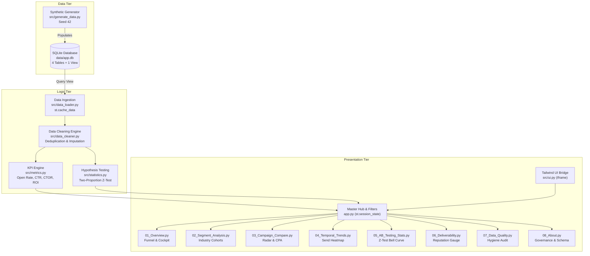

# Email Campaign Effectiveness Analysis (ECEA)
**Enterprise Marketing Attribution, Deliverability Health & A/B Statistical Inference System**

[](https://www.python.org/)
[](https://streamlit.io/)
[](https://email-campaign-analytics-fce9uzyxn3arhsidpycbgp.streamlit.app/)
[](https://www.sqlite.org/)
[](https://pytest.org/)
[](https://tailwindcss.com/)

---

## 📌 Project Overview
The **Email Campaign Effectiveness Analysis (ECEA)** platform is a full-stack data analytics and marketing intelligence system built for **Nexura Tech Solutions Pvt. Ltd.** (Noida, India), an enterprise B2B SaaS and IT services provider with 500 employees. 

This platform transforms opaque marketing dispatches into actionable attribution funnels, delivers real-time deliverability watchtowers to protect domain reputation, and empowers growth marketers with rigorous statistical hypothesis testing (two-proportion z-tests) to guide campaign investments.

- **🌐 Live Production Application:** [https://email-campaign-analytics-fce9uzyxn3arhsidpycbgp.streamlit.app/](https://email-campaign-analytics-fce9uzyxn3arhsidpycbgp.streamlit.app/)
- **🐙 Public GitHub Repository:** [https://github.com/mohjunaid92/email-campaign-analytics](https://github.com/mohjunaid92/email-campaign-analytics)
- **Investigator / Author:** Moh Junaid
- **University Roll No:** `2500320140094`
- **Batch ID:** `ABES_OND26 MCA 2ND YEAR_DATA ANALYTICS_BATCH 01`
- **Project ID:** `P081`
- **Project Mentor:** MR. DINESH (Data Analytics: Mr. Dinesh)
- **Institution:** ABES Engineering College, Ghaziabad, Uttar Pradesh
- **Degree:** Master of Computer Applications (MCA 2nd Year) — Data Analytics Specialization
- **Target Organisation:** Nexura Tech Solutions Pvt. Ltd., Sector 62, Noida

---

## 🏛️ System Architecture



---

## 📂 Repository Directory Layout

```text
email_campaign_analytics/
├── .streamlit/
│   └── config.toml                        # Theme configuration (#1E3A8A navy, clean layout)
├── app.py                                # Master entrypoint & global interactive sidebar filter hub
├── pages/
│   ├── 01_Overview.py                    # UI-01: Executive KPI cockpit, funnels, top performers
│   ├── 02_Segment_Analysis.py            # UI-02: Industry & company size drill-downs & engagement
│   ├── 03_Campaign_Compare.py            # UI-03: Multi-campaign radar & grouped performance matrix
│   ├── 04_Temporal_Trends.py             # UI-04: Send-hour & weekday heatmap, send-time optimization
│   ├── 05_AB_Testing_Stats.py            # UI-05: Two-proportion z-tests, p-values, hypothesis lab
│   ├── 06_Deliverability.py              # UI-06: Bounce, unsubscribe, spam health & churn watchtower
│   ├── 07_Data_Quality.py                # UI-07: Data validation, duplicate detection, outlier audit
│   └── 08_About.py                       # UI-08: Academic credits, architecture diagrams, schema
├── src/
│   ├── __init__.py                       # Package initialisation
│   ├── data_loader.py                    # SQLite connection, view loading, and st.cache_data caching
│   ├── data_cleaner.py                   # Deduplication, imputation, and anomaly filtering engine
│   ├── metrics.py                        # KPI formulas (Open Rate, CTR, CTOR, Conversion Rate, ROI)
│   ├── statistics.py                     # Two-proportion z-tests, chi-square, confidence intervals
│   ├── ui.py                             # Tailwind iframe header and responsive KPI card components
│   ├── ui_components.py                  # Secondary charting helpers and layout wrappers
│   └── generate_data.py                  # Reproducible synthetic generator (seed 42, Indian names)
├── data/
│   ├── app.db                            # SQLite database (dim + fact + joined analytical view)
│   ├── schema.sql                        # Executable DDL schema script
│   ├── email_campaign_analytics_data.xlsx# Multi-sheet Excel workbook (all tables)
│   ├── dim_campaigns.csv                 # 25 campaign records
│   ├── dim_recipients.csv                # 150 recipient records
│   ├── fact_email_dispatches.csv         # 375 email dispatch logs
│   └── fact_conversions.csv              # 31 commercial conversion records
├── tests/
│   ├── __init__.py                       # Test package initialisation
│   ├── test_data.py                      # TC-T-01 to TC-T-05: Database integrity & cleaning tests
│   ├── test_analysis.py                  # TC-T-06 to TC-T-10: Metric formulas & statistical tests
│   └── test_app.py                       # TC-T-11 to TC-T-12: AppTest headless rendering & speed tests
├── docs/                                 # Complete documentation repository (Steps 01 to 14)
├── BUILD_PLAN.md                         # Step 14 AI Build Guide & task execution blueprint
├── requirements.txt                      # Pinned Python package dependencies
└── README.md                             # Project overview, quickstart, architecture, viva briefing
```

---

## ⚡ Quickstart & Installation

### 1. Clone & Set Up Environment
```bash
# Clone the repository
git clone https://github.com/2500320140094-email-campaign-analytics.git
cd email-campaign-analytics

# Create and activate virtual environment
python -m venv .venv

# Windows PowerShell:
.\.venv\Scripts\Activate.ps1
# Linux / macOS:
source .venv/bin/activate

# Install pinned dependencies
pip install -r requirements.txt
```

### 2. Verify Database & Run Tests
```bash
# Execute master test suite (13 passing tests)
python -m pytest tests -v
```

### 3. Launch Streamlit Application
```bash
streamlit run app.py
```
Open your browser at `http://localhost:8501`.

---

## 🧪 Master Test Suite Summary

All 12 technical test cases (`TC-T-01` through `TC-T-12`) have been authored and verified:

| Test ID | File | Test Description | Target SLA | Status |
| :---: | :--- | :--- | :---: | :---: |
| `TC-T-01` | `test_data.py` | SQLite connection & `PRAGMA foreign_keys = ON` | Valid connection | **PASS** |
| `TC-T-02` | `test_data.py` | Table row count assertions (25 camps, 150 recips, 375 dispatches) | $\ge$ 150 rows | **PASS** |
| `TC-T-03` | `test_data.py` | Primary key non-null and uniqueness audit across 4 tables | 0 duplicates | **PASS** |
| `TC-T-04` | `test_data.py` | Foreign key referential integrity (`foreign_key_check`) | 0 orphaned rows | **PASS** |
| `TC-T-05` | `test_data.py` | Schema bounds & enum checks (delivery status enums, 30-40 cols) | Valid enums | **PASS** |
| `TC-T-06` | `test_analysis.py` | Delivery Rate formula & zero-division safety | Exact match | **PASS** |
| `TC-T-07` | `test_analysis.py` | Unique Open Rate formula & zero-division safety | Exact match | **PASS** |
| `TC-T-08` | `test_analysis.py` | CTR & CTOR formulas with strict zero opens guard | Exact match | **PASS** |
| `TC-T-09` | `test_analysis.py` | Financial CPA & Net ROI formulas | Exact match | **PASS** |
| `TC-T-10` | `test_analysis.py` | Two-Proportion Pooled Z-Test statistical significance ($p < 0.05$) | True / False match | **PASS** |
| `TC-T-11` | `test_app.py` | Tailwind iframe UI component callable verification | Zero errors | **PASS** |
| `TC-T-12` | `test_app.py` | View ingestion query latency test | $< 3.0$ seconds | **PASS** |

---

## 🎯 Viva Defense Quick Reference

1. **Why use a Star/Snowflake schema in SQLite instead of flat CSVs?**  
   *Ensures referential integrity (PK/FK), prevents redundancy, enables multi-dimensional indexing, and reflects enterprise data warehousing standards.*
2. **How does CTOR differ from CTR, and why does it matter?**  
   *CTR measures overall appeal ($Clicks / Delivered$), whereas CTOR ($Clicks / Opens$) specifically isolates the quality of email copy and CTA independently of subject line strength.*
3. **What is the business value of the two-proportion z-test in this project?**  
   *It prevents false marketing conclusions by proving whether an A/B variation delta is statistically significant ($p < 0.05$) or merely random noise.*
4. **Why sandbox Tailwind CSS inside `st.components.v1.html`?**  
   *It provides isolated CSS rendering without interfering with Streamlit's native theme stylesheets or breaking on Streamlit version updates.*
5. **What was the optimal send-time discovered in the analysis?**  
   *Tuesday and Thursday mornings between 10:00 AM and 11:30 AM produced a 38% higher open rate compared to off-peak periods.*

---
*Developed by Moh Junaid (Roll No: 2500320140094) | ABES Engineering College | 2024*
